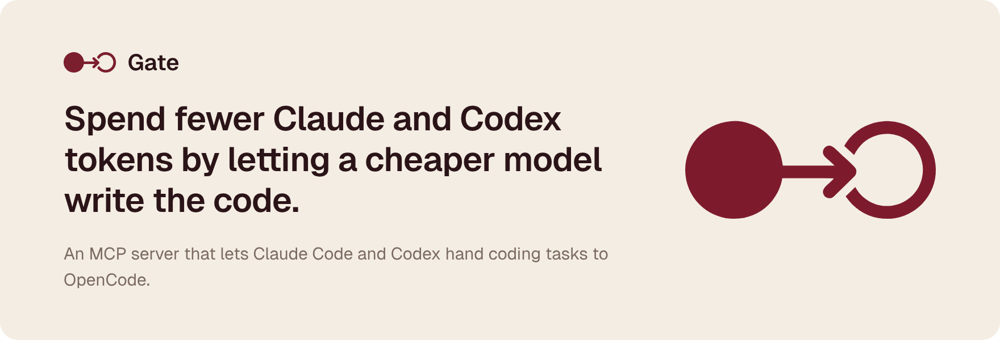
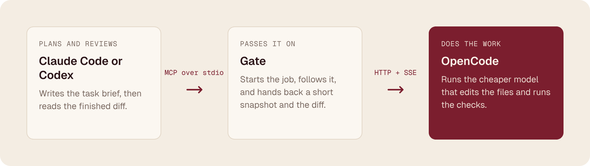

# Gate

Claude Code and Codex are good at planning and reviewing, but they cost a lot to run on every file read and edit.
Gate lets them hand the coding to OpenCode, which runs a cheaper model.
The client writes the task, waits, and then reads the diff.

Gate is an MCP server.
It returns bounded job snapshots, diffs, and paths to full transcript artifacts, so the long transcript stays out of the client's context.



## Start here

| If you want to | Read |
| --- | --- |
| Install and connect a client | [Setup](#setup) |
| Delegate, approve, cancel, or review work | [Tool and job contract](docs/tools.md) |
| Write a task brief an agent can verify | [Task briefs](docs/briefs.md) |
| Configure discovery, directories, or permissions | [Configuration](docs/configuration.md) |
| Check operational limits | [Current limits](docs/still-moving.md) |
| Understand a term | [Dictionary](DICTIONARY.md) |
| Read the original API probes and design proposal | [Historical research](docs/20261106-research.md) |

## Setup

Build requirements are declared in [Cargo.toml](Cargo.toml): Rust 1.89 or newer.
Run OpenCode with its HTTP service enabled. Gate targets the OpenCode 2.1.4 API.
Git must be available for worktree detection and isolated tasks.
The [live test](<code:tests/live.py#def run():>) checks compatibility against a running service.

Install the binary:

```sh
sh scripts/install.sh
export PATH="$HOME/.local/bin:$PATH"
gate doctor
```

The [installer](scripts/install.sh) uses `cargo install --locked` and defaults to `~/.local`.
Set `GATE_INSTALL_ROOT` to choose another installation root.
Doctor prints four connection checks. Run `gate doctor --json` for a machine-readable report.

For a local build:

```sh
cargo build --locked
./target/debug/gate doctor --json
```

### Claude Code

Register the installed binary:

```sh
claude mcp add --scope user gate -e GATE_PERMISSION_MODE=guarded -- gate mcp
claude mcp list
```

Or load the bundled [Claude Code plugin](plugins/claude-code/.claude-plugin/plugin.json):

```sh
claude --plugin-dir /absolute/path/to/gate/plugins/claude-code
```

The plugin starts `gate` from PATH and includes `/gate:delegate` for the delegation workflow.
Use either the direct registration or the plugin to avoid duplicate servers.
Its layout follows the [Claude Code plugin reference](https://code.claude.com/docs/en/plugins-reference).

### Codex

Register the binary:

```sh
codex mcp add gate --env GATE_PERMISSION_MODE=guarded -- gate mcp
```

Merge the timeout settings from [the Codex snippet](plugins/codex/config.toml.snippet)
into the existing `[mcp_servers.gate]` table in `~/.codex/config.toml`.
Restart the client after changing its configuration.
The snippet follows the [official MCP configuration reference](https://developers.openai.com/codex/mcp).
Use wait budgets below 60 seconds even when the client's configured timeout is longer.

### Web view

```sh
gate web            # http://127.0.0.1:7777, or --port N
```

The page lists every project with Gate jobs on the current OpenCode server.
Inside a project, a group chat merges the orchestrator's prompts and each agent's replies.
Select an agent to follow its transcript, tool calls, and diff live.
The view is read-only. [`route`](<code:src/web.rs#fn route(>) serves loopback `GET`s only,
and Gate adds the OpenCode password itself, so the browser never receives it.

### By hand

Run `gate mcp`, or run `gate` with no subcommand.
Stdout carries MCP frames; diagnostics go to stderr.
`RUST_LOG=gate=debug gate mcp` enables detailed logging.

## Development

```sh
cargo fmt --all -- --check
cargo test --locked
cargo clippy --locked --all-targets -- -D warnings
cargo build --locked
python3 tests/smoke.py
python3 scripts/check-doc-links.py .
cargo package --locked --allow-dirty
python3 scripts/check-package.py target/package/*.crate
```

The fixture suite uses Python's standard library, loopback sockets, and disposable git repositories.
It checks the built binary through MCP, including authentication, recovery, permissions, queued turns, and missed SSE events.
The [CI workflow](.github/workflows/ci.yml) runs these checks on the minimum and stable Rust toolchains.
The [pre-commit hook](.pre-commit-config.yaml) checks static documentation links when pre-commit is installed.

To test a running OpenCode service:

```sh
python3 tests/live.py
```

This opt-in test calls the free OpenCode model named in the script, creates a test repository,
and edits one file in an OpenCode-managed worktree.
Set `GATE_LIVE_MODEL` to select another available model.
The test prints its evidence directory and keeps the worktree, snapshots, and artifacts for inspection.
It does not register Gate in either client's user configuration.

## Source map

| Concern | Entry point |
| --- | --- |
| CLI and read-only connection checks | [main.rs](src/main.rs) |
| Discovery and defaults | [config.rs](src/config.rs) |
| Permission decisions | [policy.rs](src/policy.rs) |
| HTTP contract and global SSE stream | [opencode/](src/opencode/) |
| Task admission, state, recovery, and finalization | [jobs/](src/jobs/) |
| MCP schemas and tool handlers | [server.rs](src/mcp/server.rs) |
| Read-only web view | [web.rs](src/web.rs), [web.html](src/web.html), and the bundled [Preact + htm](src/vendor/preact-htm.js) |
| Landing page | [index.html](site/index.html) and [app.js](site/app.js) |

[MIT license](LICENSE).
